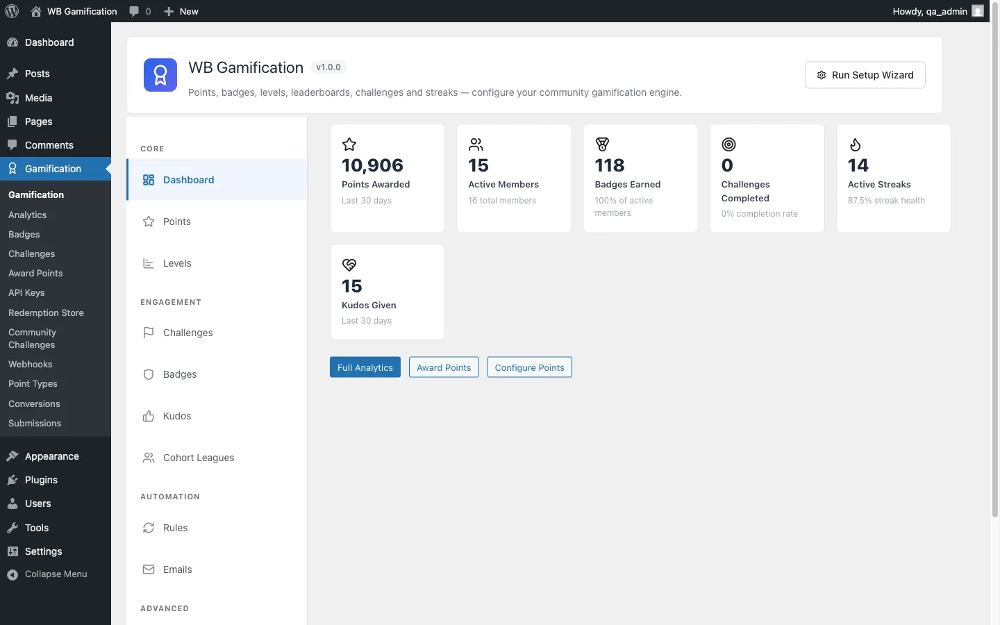

# Quick Start Guide

Get WB Gamification running in five minutes. This guide shows you the complete loop from activation to your first member earning points.

## Step 1: Activate and Run Setup (2 minutes)

1. Activate the plugin from **Plugins > Installed Plugins**.
2. Setup opens automatically. It lists the plugins on your site that reward members.
3. Switch off any plugin you do not want to reward, then click **Continue**.
4. Pick a pace. **Balanced** uses each plugin's own limits and suits most sites.
5. Review your levels, badges and leaderboard, then choose your emails.
6. Click **Launch gamification**.

Setup saves your choices and takes you to **Overview > Dashboard**. See [Setup](20-setup-wizard.md) for every step.

## Step 2: Check What Is Already Working (30 seconds)

Go to **Gamification > Earning > Actions and points**. You will see every action that is currently active on your site - things like "Post an activity update," "Join a group," and "Complete a course." These are already wired up. No additional configuration is needed.

## Step 3: Have a Member Do Something (1 minute)

Log in as a regular member. Do one of the active actions - for example, post an activity update on a BuddyPress community page, or leave a comment on a blog post.

Within a few seconds, a toast notification appears at the bottom-center of the screen showing how many points were earned.

## Step 4: Check the Member's Points (30 seconds)

Points appear immediately in three places:

- The **member-points block** on any page where you have placed it
- The member's **BuddyPress profile** under the Gamification tab (if BuddyPress is active)
- **Gamification > Members > Members** in the admin, where you can view any member's full point history

## Step 5: View the Analytics Dashboard (30 seconds)

Go to **Gamification > Overview > Analytics**. You will see KPI cards showing total points awarded, active members, badges earned, and more. The dashboard refreshes whenever points are awarded, revoked or spent.

## What Happens Automatically

From here, the plugin handles everything on its own:

- Members earn points as they take actions
- Badges award automatically when members meet the conditions
- Levels advance when members cross point thresholds
- Streaks build each day a member is active
- The leaderboard updates on a rolling basis

You do not need to do anything to keep it running. Explore **Gamification > Rewards > Badges**, **Levels**, and **Challenges** to customize the experience for your community.
