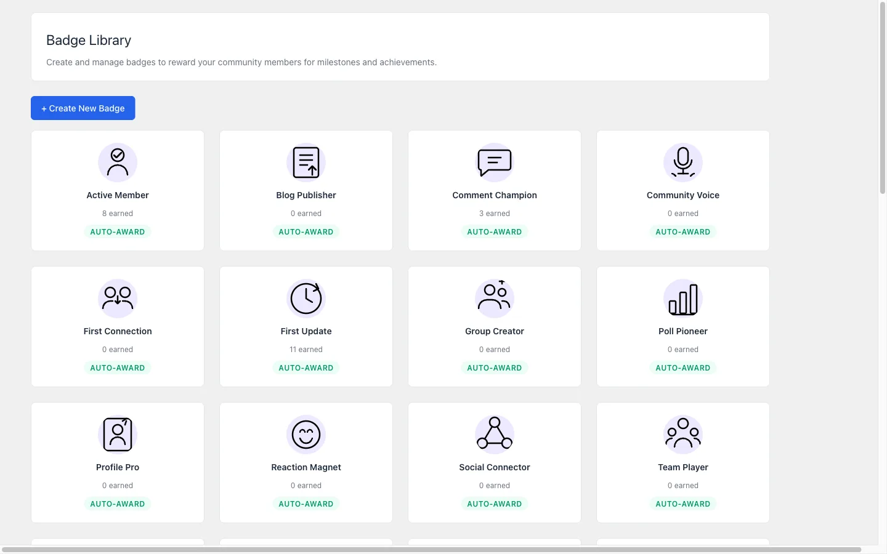

# Badge Management

Go to **Gamification > Badges** in your admin menu.

The Badge Library shows every badge as a card. Each card shows the badge icon, its name, how many members have earned it, and **Auto-award** or **Manual**: whether it is given out on its own or only by hand. A badge whose actions come from a plugin your site does not run (for example a BuddyPress badge without BuddyPress) shows **Not earnable here** instead. Members do not see it, unless they already earned it.

## Creating a New Badge

Click **+ Create New Badge** at the top of the screen. The form has the badge details first, then the award conditions.

### Badge Details

| Field | Required | Description |
|-------|----------|-------------|
| **Badge ID** | Yes | A unique identifier. Lowercase letters, numbers and underscores only (for example `first_post`). It cannot be changed after creation. |
| **Name** | Yes | The name members see when they earn the badge (for example "First Post"). |
| **Description** | No | What the badge is for. Shown on badge cards and the share page. |
| **Icon** | No | An image from your Media Library. Recommended: 128x128 px PNG with a transparent background. Click **Choose Icon** to pick one, **Remove** to clear it. |
| **Category** | No | Groups badges in the front-end showcase: General, Points, WordPress, BuddyPress or Special. |
| **Is Credential** | No | Makes the badge a verifiable OpenBadges 3.0 credential. Members can share a verified badge link, for example on LinkedIn. |
| **Valid for (days)** | No | Days the badge stays valid after a member earns it. Then it expires and stops counting. Leave blank so it never expires. |
| **Closes at** | No | No one can earn the badge after this date and time. Leave blank for no cutoff. Shown in your site's timezone. |
| **Max earners** | No | The badge stops awarding once this many members have it. Leave blank for unlimited. |

### Auto-Award Conditions

This section decides how the badge is earned. Pick a condition from the list and fill in its value. Click **+ Add condition** to add another, and **Remove this condition** (the x button) to take one away. With two or more conditions, choose whether the member must match **ALL of these** or **ANY of these**.

| Condition | What you fill in | Awards when |
|-----------|------------------|-------------|
| **Admin awarded only (manual)** | Nothing | Never on its own. You grant it from the badge's own page. |
| **Reaches a point total** | A number of points | The member's total points reach that number. |
| **Performs an action N times** | An action and a number of times | The member has done that action that many times. |
| **Reaches a level** | A level | The member reaches that level. |
| **Has earned another badge** | A badge | The member already holds that badge. |
| **Keeps a daily streak of N days** | Days in a row | The member's daily streak reaches that many days. |
| **Has been a member for N days** | Days since joining | That many days have passed since the member registered. Checked once a day. |
| **Earns N points in a period** | Points, and a day, week or month | The member earns that many points within one day, week or month. |

### Members Who Already Qualify

**Also award this badge to members who already qualify** is off by default. Leave it off and the badge is earned from now on. Tick it and every member who already meets the conditions is awarded the badge in the background. On a large community that can be many people and many notifications. When a run has happened, the form shows how many members it checked and how many got the badge.

Click **Create Badge** to save.

## Editing a Badge

Click any badge card to open its form. Every field can be changed except the Badge ID. Click **Save Changes** when you are done. Changing a condition does not award the badge to anyone who already qualifies unless you tick **Also award this badge to members who already qualify**.

## Awarding a Badge by Hand

Open the badge. Under **Award this badge to a user**, type at least 2 characters of a member's name, username or email, pick the member, and click **Award Badge**. This works for every badge, including badges that also award on their own.

## Deleting a Badge

Open the badge and click **Delete Badge**, then confirm. This removes the badge and every record of members earning it. Members who held it lose it from their profiles. This cannot be undone.

## The 37 Default Badges

A fresh install includes 37 badges: point totals, first posts and comments, BuddyPress activity, admin-granted special badges, tenure badges and site-first badges. They appear in the library straight away. You can edit or delete them, or add your own. The full list is in [Badges](../features/20-badges.md#default-badges).

## FAQ

**Why is a badge marked Manual?**
Its only condition is **Admin awarded only (manual)**. Add any other condition to make it award on its own.

**Can I change a Badge ID?**
No. Create a new badge with the ID you want and delete the old one. Members lose the old badge when you delete it.

## Troubleshooting

**Members who should have a badge do not have it.** The badge is earned from now on. Open it, tick **Also award this badge to members who already qualify**, and click **Save Changes**.

**A badge stopped awarding.** Check its **Closes at** date and **Max earners** limit.
